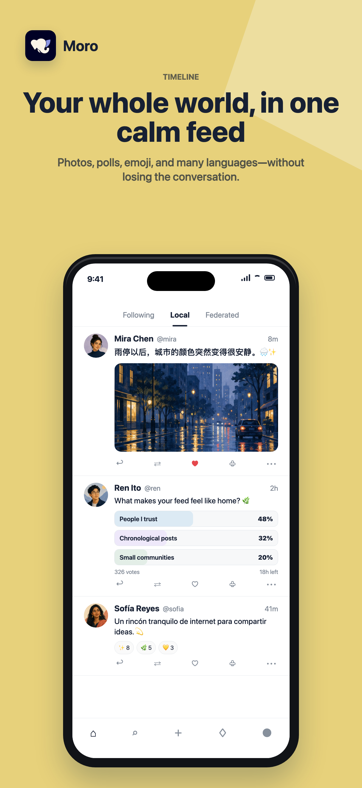
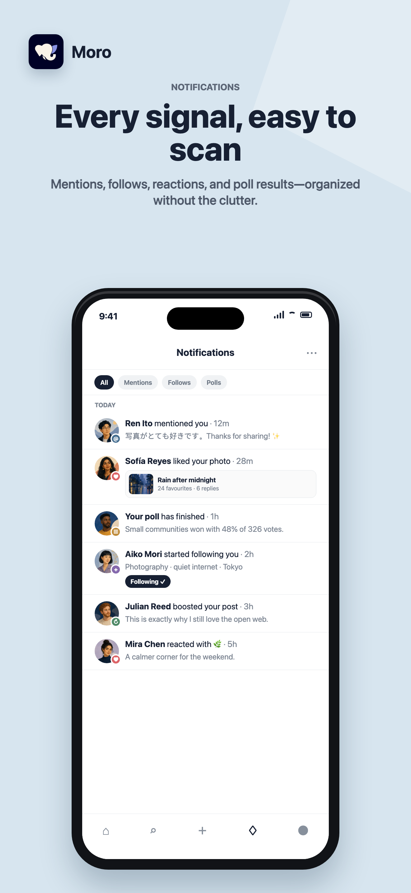
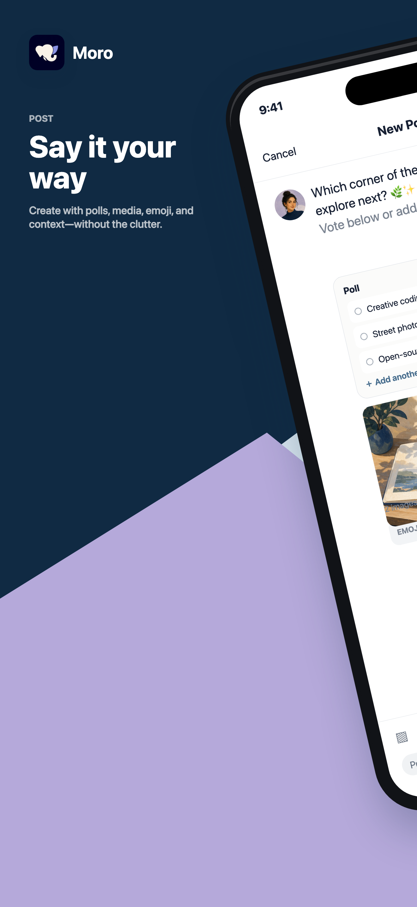

<p align="center">
  
</p>

<h1 align="center">Moro for Mastodon</h1>

<p align="center">
  A calm, light, and privacy-respecting Mastodon client for iPhone.
</p>

<p align="center">
  <a href="https://moro.somincola.com/">Website</a> ·
  <a href="https://apps.apple.com/app/id6776115614">App Store</a> ·
  <a href="https://moro.somincola.com/privacy">Privacy</a> ·
  <a href="https://moro.somincola.com/support">Support</a>
</p>

> [!NOTE]
> The App Store listing may remain unavailable while Moro is under review. The link above already targets Moro's permanent Apple ID and will continue to work after release.

Moro brings a focused, native iOS experience to the fediverse. Sign in with an account from any compatible Mastodon server, follow conversations, discover communities, and post without ads or unnecessary noise.

## Preview

These promotional previews use fictional demo accounts, deterministic UI states, and editorial illustrations. No real account or timeline data is shown.

<p align="center">
  
  
</p>

<p align="center">
  
</p>

## Highlights

- Read Following, Local, and Federated timelines in a clean, distraction-free layout.
- Post, reply, and quote with media, polls, alt text, content warnings, language selection, drafts, and per-post visibility.
- Search posts, people, and hashtags, or browse trending topics and recommended accounts.
- Keep up with notifications, direct messages, bookmarks, favourites, and lists.
- Explore rich profiles with custom emoji, pinned posts, links, and server-aware navigation.
- Add polished Home Screen widgets for quick actions, account overview, profile stats, and a quiet decorative moment.
- Protect app-switcher snapshots with Moro's branded privacy shield when the app leaves the foreground.
- Share links, text, and images into Moro from other apps.
- Choose from multiple app icons and use Moro in nine localized languages.
- Enjoy native accessibility support, including Dynamic Type and VoiceOver.

## Download

Moro requires iOS 17 or later and works with any compatible Mastodon instance.

- [Download Moro on the App Store](https://apps.apple.com/app/id6776115614)
- [Visit the Moro website](https://moro.somincola.com/)

Moro is an independent, third-party Mastodon client and is not an official Mastodon app.

## Privacy

Moro has no ads and does not use behavioral tracking. Account credentials are stored in the iOS Keychain, and your social content remains between your device and the Mastodon server you choose. See the [Privacy Policy](https://moro.somincola.com/privacy) for details.

## Development

1. Open `moro.xcodeproj` in Xcode 16 or later.
2. Select the `moro` scheme and an iOS 17+ simulator.
3. Copy the secrets sample when local credentials are required; never commit real tokens.
4. Build and run from Xcode, or use the commands below.

```bash
xcodebuild -project moro.xcodeproj -scheme moro -sdk iphonesimulator -configuration Debug build
xcodebuild -project moro.xcodeproj -scheme moro -destination 'platform=iOS Simulator,id=460D37C1-EE1F-440D-9F0C-BAB4A85EC694' -configuration Debug test -only-testing:moroTests
```

### Project layout

| Path | Purpose |
| --- | --- |
| `moro/App` | App entry point, lifecycle, and navigation shell |
| `moro/Modules` | Auth, Timeline, Post, Profile, Settings, and other features |
| `moro/Core` | Models, stores, Mastodon API, persistence, and shared services |
| `moro/UI` | Theme and reusable SwiftUI components |
| `moroWidgetShared` | Shared WidgetKit intents and snapshot storage |
| `moroWidgets` | Moro Home Screen widgets |
| `moroTests` | Unit and integration tests |
| `docs` | Current product baselines, interaction contracts, and engineering guides |

See [docs/README.md](docs/README.md) for the current documentation map.

<details>
<summary>App Store identifiers</summary>

| Field | Value |
| --- | --- |
| Bundle ID | `com.somincola.moro` |
| SKU | `moro` |
| Apple ID | `6776115614` |
| App Store URL | `https://apps.apple.com/app/id6776115614` |

</details>

## License

Moro's source code is proprietary and confidential. See [LICENSE](LICENSE) for the applicable terms. Third-party components remain subject to their respective licenses and notices.
