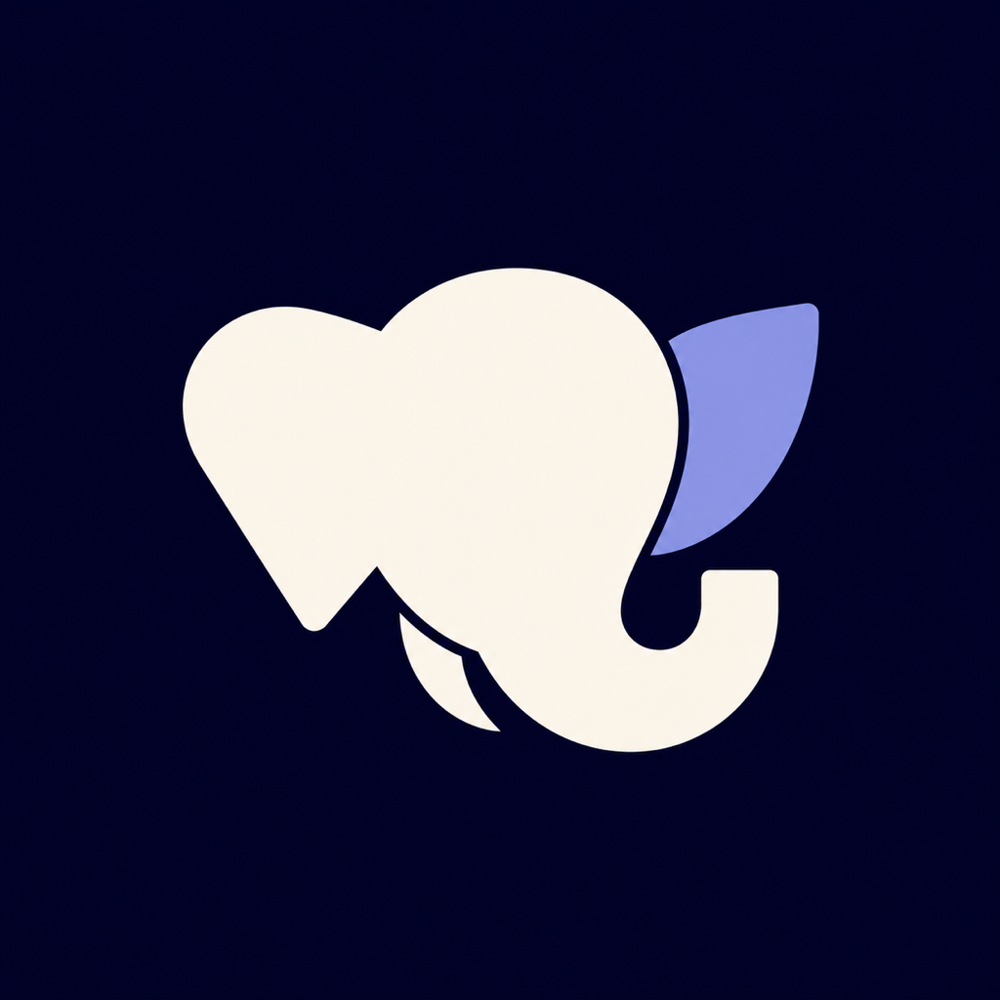
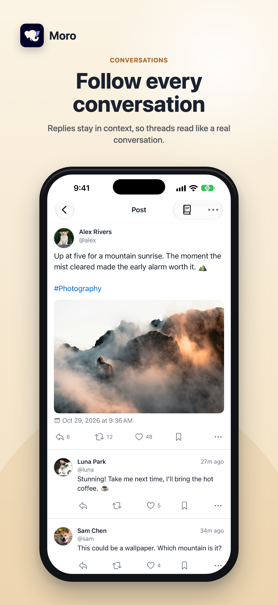
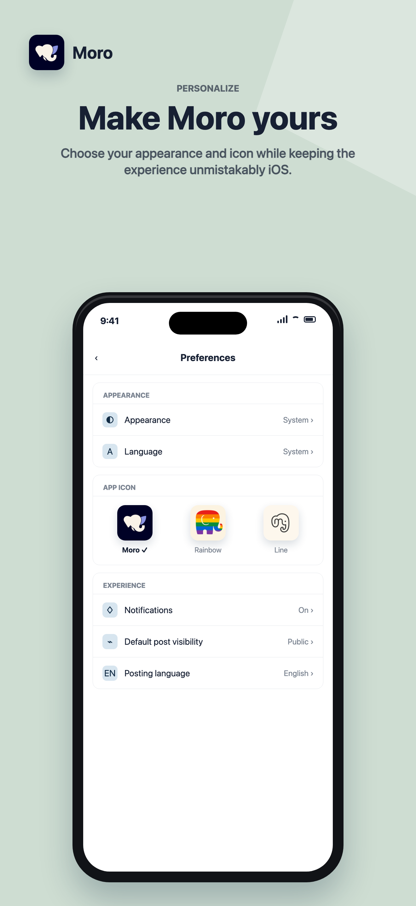

<p align="center">
  
</p>

<h1 align="center">Moro for Mastodon</h1>

<p align="center">
  <strong>轻盈、简单、友善。</strong><br>
  为 iPhone 打造，在联邦宇宙中安心阅读、自在交流。
</p>

<p align="center">
  <a href="https://github.com/somincola/moro-ios/releases/latest"></a>
  <a href="https://apps.apple.com/app/id6776115614"></a>
  <a href="https://github.com/topics/swiftui"></a>
  <a href="https://github.com/topics/mastodon-client"></a>
  <a href="LICENSE"></a>
</p>

<p align="center">
  <a href="https://apps.apple.com/app/id6776115614"></a>
</p>

<p align="center">
  <a href="https://getmoro.app/">官方网站</a> ·
  <a href="https://github.com/somincola/moro-ios/releases">版本更新</a> ·
  <a href="https://getmoro.app/support">支持与反馈</a> ·
  <a href="README.md">English</a>
</p>

## 认识 Moro

Moro 是一款面向 iPhone 的原生 Mastodon 客户端，以**轻盈、简单、友善**为核心。带上你在兼容 Mastodon 服务器上的账号，阅读清晰的时间线，参与有条理的对话，分享自己的日常。

关注喜欢的社区，在多个账号之间切换，回到上次阅读的位置。也可以调整主题色、帖子字号和应用图标，让 Moro 更合自己的习惯。

<p align="center">
  <a href="https://apps.apple.com/app/id6776115614"></a>
  <a href="https://apps.apple.com/app/id6776115614"></a>
</p>

<p align="center">
  <sub>精选两张 App Store 官方宣传图。<a href="https://apps.apple.com/app/id6776115614">在商店查看更多</a> · <a href="docs/assets/readme/SOURCES.md">素材来源</a></sub>
</p>

## 把空间留给真正关心的内容

| 体验 | 你可以做的事 |
| --- | --- |
| **按自己的节奏阅读** | 浏览关注、本站、跨站和列表时间线；返回时保留阅读位置，准备好后再查看新嘟文。 |
| **轻松跟上对话** | 阅读讨论串、回复和引用，翻译帖子，查看提及、喜欢、转嘟与私信。 |
| **自在地表达** | 分享照片或视频，添加投票、保存草稿，设置替代文本、内容警告、发布语言和可见性；也能从相册直接分享至编辑器。 |
| **集中管理多个账号** | 登录不同服务器上的账号，长按切换；在同一页编辑个人资料、头像、封面和附加信息。 |
| **用自己喜欢的样子** | 自选主题色、帖子字号与应用图标；支持九种语言、动态字体和 VoiceOver。 |
| **融入 iPhone 日常** | 使用主屏幕 Widget 与系统分享面板；在 iPhone Duo 上展开双栏，为阅读和对话留出更多空间。 |

## 账号与选择，都属于你

Moro **没有广告，也不进行跨应用追踪**。账号直接连接你选择的 Mastodon 服务器，凭证保存在 iOS Keychain 中。

通知投递、可选的 Apple 诊断共享，以及各项服务的边界，可查阅[隐私政策](https://getmoro.app/privacy)与[透明度说明](https://getmoro.app/transparency)。

## 下载与后续更新

- **下载应用：** [App Store](https://apps.apple.com/app/id6776115614)，支持 iOS 18 及以上版本。
- **了解产品：** [Moro 官方网站](https://getmoro.app/)。
- **查看更新：** [最新版本](https://github.com/somincola/moro-ios/releases/latest)、[全部 Releases](https://github.com/somincola/moro-ios/releases)与[完整更新日志](CHANGELOG.md)。
- **支持与反馈：** [支持页面](https://getmoro.app/support)或 [GitHub Issues](https://github.com/somincola/moro-ios/issues)。

## 开发者入口

Moro 使用 Swift 与 SwiftUI 构建，包含分享扩展、通知服务扩展和 WidgetKit 组件。产品行为、架构与系统集成说明见[文档索引](docs/README.md)。

<details>
<summary>本地构建与项目结构</summary>

使用 Xcode 26.6 或更新版本打开 `moro.xcodeproj`，选择 `moro` scheme 和已安装的 iOS 18+ 模拟器。CI 工具链版本以 [`.github/workflows/ci.yml`](.github/workflows/ci.yml) 为准。

```bash
xcodebuild -project moro.xcodeproj -scheme moro -sdk iphonesimulator -configuration Debug build
```

| 路径 | 用途 |
| --- | --- |
| `moro` | 主应用、功能模块、共享服务与 SwiftUI 组件 |
| `moroShareExtension` | 系统分享面板至发帖编辑器的导入 |
| `moroNotificationService` | 推送通知处理 |
| `moroWidgets` / `moroWidgetShared` | Widget、Intent 与共享快照 |
| `moroTests` / `moroUITests` | 单元、集成与界面测试 |
| `metadata/app-store` | 商店多语言资料 |
| `docs` | 产品与工程文档 |

</details>

---

Moro 是由 Somincola 开发的独立 Mastodon 客户端。源码与应用素材适用[专有许可证](LICENSE)，第三方素材保留各自的许可条款。© 2025–2026 Somincola。保留所有权利。
