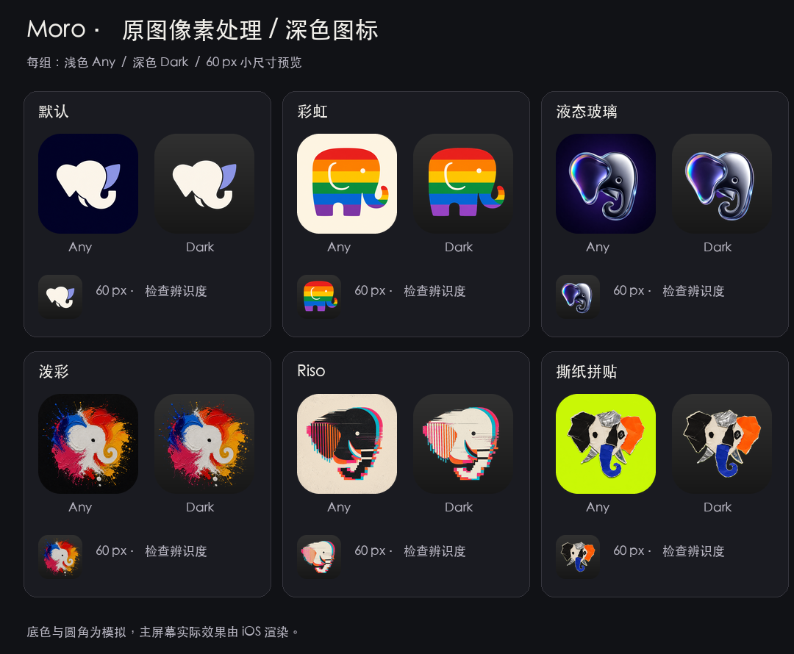
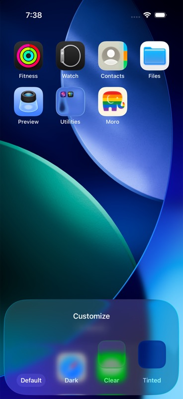
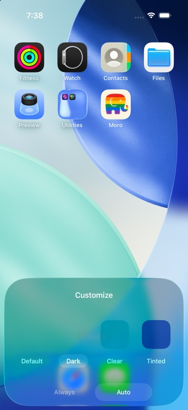
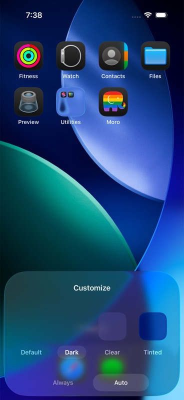
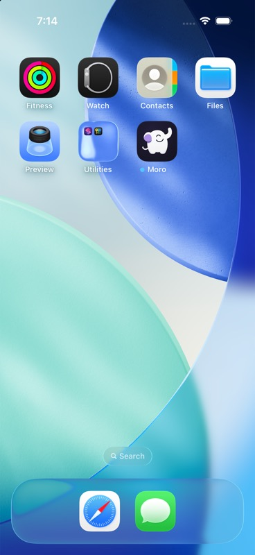
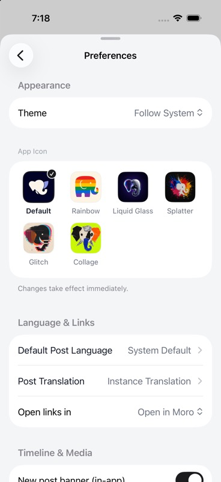
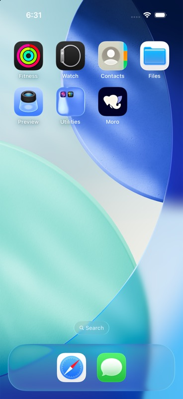
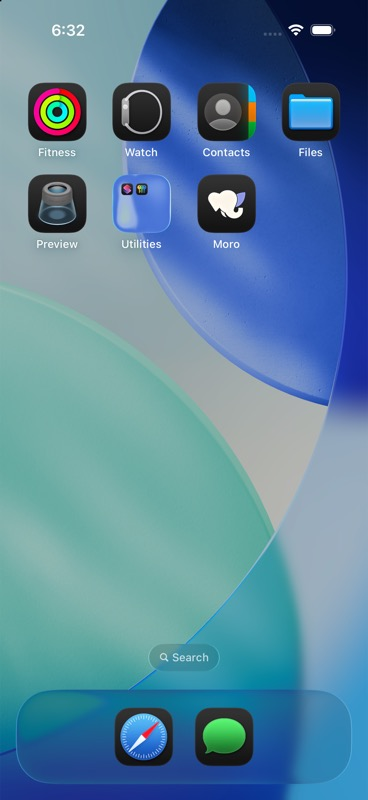

# 深色 App Icon

为默认图标和 8 款替换图标提供 `Any` / `Dark` 资源：默认、彩虹、液态玻璃、泼彩、故障、拼贴、苹果软糖、斑马印刷、还没醒。正式资源直接处理现有 1024 × 1024 原图像素。2026-09-18 调整后四款的构图比例，随后加入三款大象角色图标。

[三款新图标的资源说明](character-icons/README.md)：软糖和斑马采用第二轮原版，“还没醒”采用第三轮漫画大象。Any 与选定成图逐字节一致，Dark 只调整背景。原有六款图标如下。



[打开交互对比页](preview.html)：可切换 60 / 96 / 180 px，以及深灰、纯黑、中灰、棋盘格底色。底色和圆角为近似模拟。

[查看尺寸调整前后与模拟器验证](size-adjustment/README.md)：液态玻璃放大 22%，泼彩中央白色象头放大约 25%，故障缩小 16%，拼贴缩小 20%。浅色、深色与设置页预览同步更新；[原尺寸审计](size-audit/README.md)保留作为调整前的记录。

## 移除经典与线稿图标

两款的图标集、应用内预览、枚举、翻译和构建配置均已移除。探索期间的经典重绘稿未进入正式资源。

应用每次进入前台时，读取系统当前图标名称。若名称仍对应受支持的图标，就保留该选择并同步本地设置；若名称已不存在，就调用 `setAlternateIconName(nil)` 切回默认图标。只有系统回调成功才完成同步；临时资源繁忙沿用现有重试，其他失败会在下次进入前台再次尝试。图标切换期间阻止重复请求。

旧设置中的 `classic` / `lineElephant` 会按现有枚举解码规则回退为 `.default`；即使 iOS 在升级时已经自动重置图标，本地设置也会随首次进入前台更新。不能把“删除 PNG”当作覆盖所有系统缓存情况的保证。

Apple 明确规定传入 `nil` 会选择主图标，见 [setAlternateIconName](https://developer.apple.com/documentation/uikit/uiapplication/setalternateiconname(_:completionhandler:))。

## 视觉检查

以下为原图对照和 60 px 预览中的观察。

| 图标 | 处理 | 小尺寸观察 |
| --- | --- | --- |
| 默认 | 去除深蓝底，保留象牙白主体与紫耳朵 | 几何轮廓与负空间清楚。 |
| 彩虹 | 去除浅底，适度提亮紫色条带 | 条带和象鼻保留，暗底上的紫色腿部可以辨认。 |
| 液态玻璃 | 放大 22%；深色按金属轮廓提取并略提亮暗部 | 银色象头更醒目，保留虹彩反射与周围留白。 |
| 泼彩 | 白色象头局部放大约 25%，向外围笔触平滑过渡 | 中央形状更容易识别；最外圈飞溅保留原位置。 |
| 故障 | 主体缩小 16%，延展原纸底；深色主黑墨转浅色 | 保留错位套印与颗粒，减轻贴边的拥挤感。 |
| 拼贴 | 主体缩小 20%，延展原黄绿底，保留纸张阴影 | 撕边、铝箔与黑纸更完整地落在图标内部。 |

## 资源配置

- 9 个 `.appiconset` 使用 Single Size：`idiom: universal`、`platform: ios`、`size: 1024x1024`。
- `Any` 为不透明 PNG；`Dark` 使用 `luminosity: dark`。原有六款使用透明 PNG，由系统铺设暗底；新增三款使用不透明深色 PNG，保留各自的背景色调与纹理。资源中没有预先画圆角。
- 移除手工缩放的 120 / 152 / 167 / 180 px 副本，由 Xcode 生成所需尺寸。
- 主图标仍为 `AppIcon`，替换图标为 Rainbow、LiquidGlass、PaintChaos、RisoGlitch、TornCollage、AppleGummy、ZebraPrint、NotAwake。
- 9 个应用内预览图像集均提供 240 × 240 的 Any / Dark 图片。透明深色预览合成近似暗底，新增三款保留自己的深色背景；SwiftUI 按资源名加载并跟随应用的外观环境。
- Tinted 使用系统自动处理。以后手制 Tinted 时应提供灰度图。

主屏幕图标外观由系统自定设置控制，可独立于应用内主题。参考 [Configuring your app icon using an asset catalog](https://developer.apple.com/documentation/xcode/configuring-your-app-icon)。

仅从控制中心切换系统深色模式，不保证桌面图标一起切换。iOS 26 中，长按桌面背景 → 编辑 → 自定义 → 深色 → 自动，图标才跟随系统明暗；“默认”保持浅色图标，“深色 → 始终”保持深色图标。参考 [Apple 主屏幕自定义说明](https://support.apple.com/zh-cn/guide/iphone/iph385473442/26/ios/26)。应用调用图标集名称，由系统选取该图标集的 Any / Dark 资源。

## 验证记录

- 2026-09-17，`moro` Debug / iPhone 17 Pro / iOS 26.5 构建通过；3 条警告来自未修改的 Swift 文件，没有图标资源警告。
- `AppIconChoiceTests` 6 项通过，覆盖退役图标恢复默认、受支持的选择保持不变，以及恢复失败后再次进入前台重试。
- 2026-09-17 编译产物仅包含 5 款替换图标与 6 份 Dark 图像；经典与线稿均已清除。当时 6 份 Any 原图与分支起点逐字节一致；9 月 18 日的比例调整随后更新了其中四款。
- 在已经选择经典图标的模拟器上覆盖安装新版，首次打开后桌面显示默认图标，设置页选中默认且仅展示 6 款图标。
- 默认图标的 Any / Dark 系统外观已验证；彩虹图标另验证了系统浅色 / 深色与桌面“默认 / 深色自动”的组合。
- 2026-09-18 比例调整后，Debug / iPhone 17 Pro / iOS 26.5 构建通过，0 警告、0 错误；6 款设置页预览的 Any / Dark、液态玻璃桌面 Any / Dark，以及其余三款桌面 Dark 均完成检查。原图保留与脚本重复生成的一致性检查通过。详见[本次验证记录](size-adjustment/README.md)。

| 系统深色 + 桌面默认：仍为浅色图标 | 系统浅色 + 桌面自动 | 系统深色 + 桌面自动 |
| --- | --- | --- |
|  |  |  |

| 升级前使用经典图标 | 升级后回到默认图标 | 新设置页 |
| --- | --- | --- |
|  |  |  |

| 默认主屏幕 Any | 默认主屏幕 Dark |
| --- | --- |
|  |  |

## 重新生成

脚本依赖 Pillow 与 NumPy。按背景颜色提取透明度并去除边缘旧底色；故障调整主墨色，彩虹紫色与金属暗部有限提亮。四款构图调整始终从 [`source-originals/`](source-originals/README.md) 的原图开始，生成 Any / Dark 和应用内预览，不会在上次输出上累计缩放。故障、拼贴缩小后，使用原背景采样延展底色与纹理；泼彩以同一网格处理两种外观。其余两款保留 Any 原图，生成 Dark 与深色预览。对比图字体使用 macOS 黑体。

```sh
python3 scripts/generate-dark-app-icons.py
```

实现见 [`scripts/generate-dark-app-icons.py`](../../../scripts/generate-dark-app-icons.py)。

新增三款使用独立脚本，从 `source-originals/` 中已选定的成图生成，不改变原有六款资源：

```sh
python3 scripts/generate-character-app-icons.py
```
