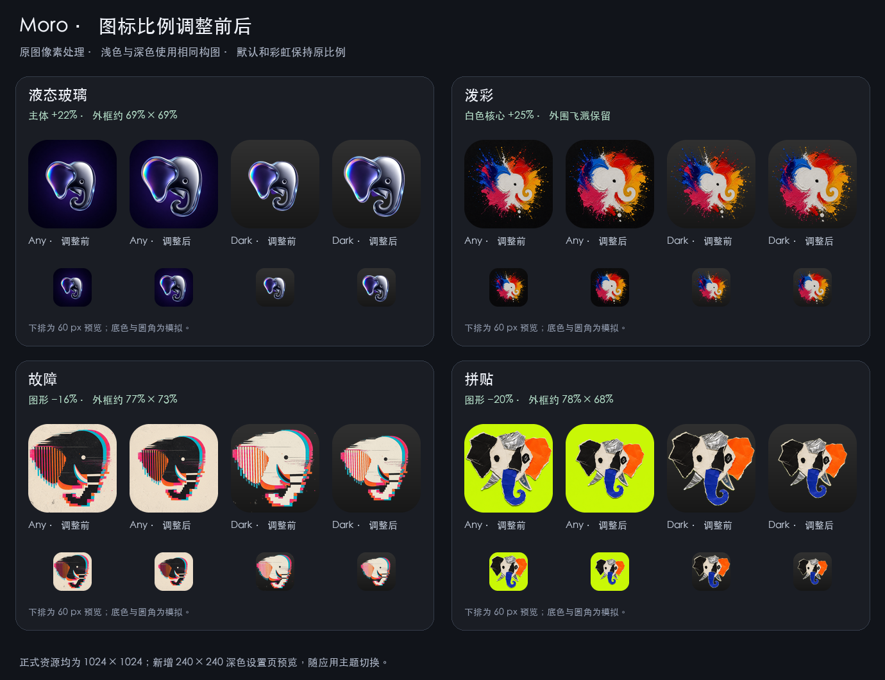
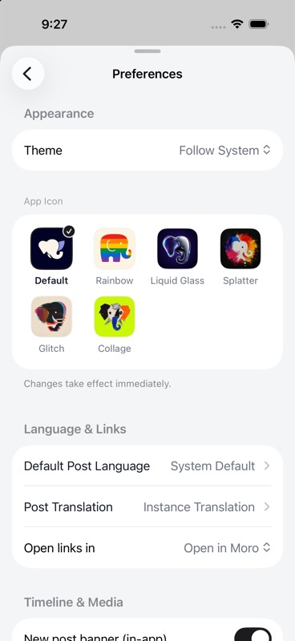
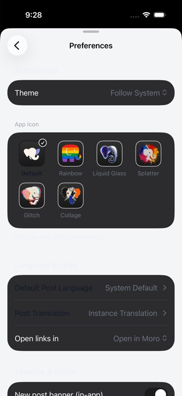
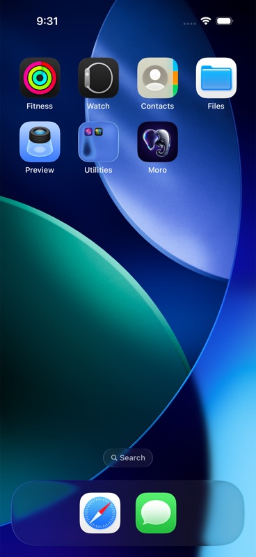
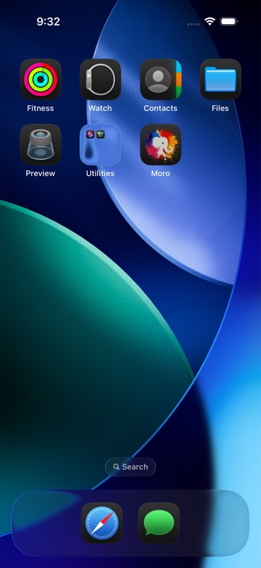
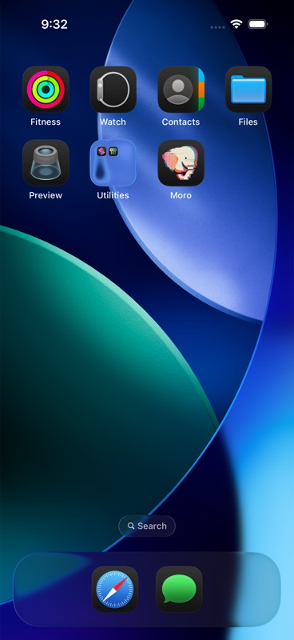
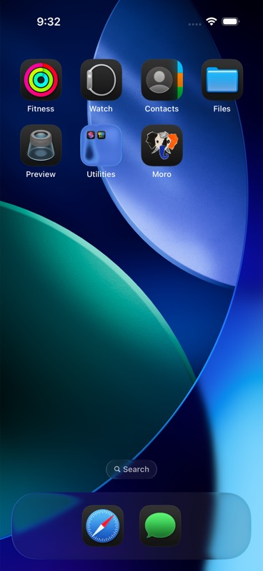

# 图标比例调整 · 2026-09-18

按已确认的尺寸审计调整四款图标，保留原画风与像素细节。所有百分比为线性尺寸变化，不是面积变化。

| 图标 | 实际调整 | 主体宽 × 高占画布比例（前 → 后） |
| --- | --- | --- |
| 默认 | 保持原样 | 63.6% × 48.4% |
| 彩虹 | 保持原样 | 76.0% × 68.1% |
| 液态玻璃 | 放大 22% | 56.3% × 56.2% → 68.7% × 68.5% |
| 泼彩 | 中央白色象头放大约 25% | 白色主体 38.4% × 38.0% → 48.0% × 47.8% |
| 故障 | 主体缩小 16% | 91.2% × 86.7% → 76.6% × 72.9% |
| 拼贴 | 主体缩小 20% | 97.3% × 85.2% → 77.8% × 68.1% |

比例按主要连通轮廓测量，排除微小孤立颗粒，存在取整和阈值误差，不代表 Apple 规定的安全区。泼彩的彩色主要笔触范围仅由 86.3% × 81.9% 变为 88.9% × 85.1%；白色主体采用局部放大与轻微位置调整，最外圈飞溅保持原位置。量化结果见 [metrics.json](metrics.json)。

故障和拼贴将主体与背景分开缩小，用原图背景的颜色和纹理样本延展留白，保留纸边与阴影。四款原图保存在 [source-originals](../source-originals/README.md)，重复运行生成脚本不会累计缩放。默认和彩虹的 Any / Dark 正式资源与本次调整前逐字节一致。

## 同步与验证

- 六组桌面图标均为 1024 × 1024：Any 不透明、Dark 带透明背景；浅色与深色使用相同的构图变换。
- 六组设置页预览均为 240 × 240，新增深色变体。SwiftUI 按资源名加载，跟随外观环境切换。
- `moro` Debug / iPhone 17 Pro / iOS 26.5 构建成功，0 警告、0 错误。编译配置保留 5 款替换图标。
- 原始图片保留、所有资源引用与尺寸检查通过；重复生成的 30 个图标、预览和预览配置文件逐字节一致。
- 模拟器检查了六款设置页预览的浅色、深色切换；液态玻璃桌面浅色、深色，以及泼彩、故障、拼贴桌面深色均使用更新后的资源。
- 此次属于图片与资源加载方式调整，未重复执行上一轮已通过的 6 项退役图标回退测试。

| 设置页浅色 | 设置页深色图标预览 |
| --- | --- |
|  |  |

以上设置页使用 `UITEST_SETTINGS_SHEET` 测试入口。该入口固定注入浅色 `MoroTheme`，因此深色截图中的页面自定义颜色仍偏浅；此截图仅验证六款图片的深色变体切换，不作为完整页面深色主题的验证。

| 液态玻璃 · 浅色 | 液态玻璃 · 深色 |
| --- | --- |
|  |  |

| 泼彩 · 深色 | 故障 · 深色 | 拼贴 · 深色 |
| --- | --- | --- |
|  |  |  |

桌面深色截图使用系统的“深色”图标外观。验证结束后，模拟器已恢复默认应用图标、默认桌面图标外观及系统浅色模式。
