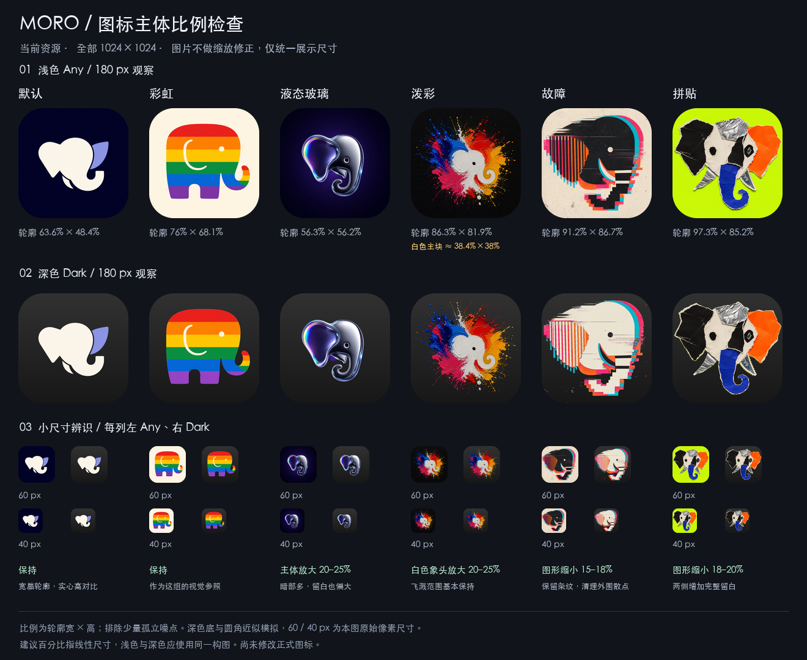

# 图标尺寸与视觉占比评估

2026-09-17；检查当前 `codex/app-icon-dark-mode` 分支中的 6 款图标。评估结论：默认和彩虹保留，液态玻璃增大主体，泼彩增大白色象头并重新平衡飞溅，故障和拼贴收小图形。

## 检查步骤与结果

1. **实际设置页：存在视觉大小差异。** 本轮重新打开模拟器设置页并截取当前界面，6 个预览容器均为 56 × 56 pt；液态玻璃和泼彩的识别主体显小，故障与拼贴更满。预览文件均为 240 × 240 px，大小差异来自图内构图。
2. **资源尺寸与留白：文件规格一致，内容占比不一致。** 12 份正式 Any / Dark 文件均为 1024 × 1024 px；Any 为 RGB，Dark 为 RGBA。下面的比例由当前深色前景蒙版测量，并结合原图检查，表示可见图形外框的宽 × 高占画布比例，不是非背景像素面积。
3. **浅深色及小尺寸对照：需要有区别地调整。** 使用当前资源制作统一尺寸对比，观察 180、60、40 px 下的识别情况。默认高对比实心主体不需要与彩虹强行保持相同外框；泼彩需要区分白色核心与外围彩色笔触。

## 逐款判断

| 图标 | 当前主要图形外框约占画布 | 判断 | 建议起始幅度 |
| --- | --- | --- | --- |
| 默认 | 63.6% × 48.4% | 宽扁轮廓与实心浅色使识别稳定；面积小不等于视觉弱 | 保持 |
| 彩虹 | 76.0% × 68.1% | 轮廓完整、色块清楚、留白适当，可作为这组视觉参照 | 保持 |
| 液态玻璃 | 56.3% × 56.2% | 上下左右余量大，内部暗面与底色接近，60 px 时显弱 | 主体线性放大 20–25%，外框约到 68–70% |
| 泼彩 | 白色核心约 38.4% × 38.0%；主要笔触 86.3% × 81.9%；连同细小飞溅约 92.8% × 91.9% | 先看到彩色团块，象头不够突出。直接整体放大会将飞溅挤出边缘 | 白色主体线性放大 20–25%，飞溅整体范围基本保持，并重新检查主体的视觉居中 |
| 故障 | 91.2% × 86.7%，不计外围孤立纸纹颗粒 | 左侧条纹靠边，实心黑块或浅色块偏重，和默认、液态玻璃不协调 | 前景图形线性缩小 15–18%，约到宽 75–78%、高 71–74% |
| 拼贴 | 97.3% × 85.2% | 左右耳几乎贴边，纸片层次在小尺寸挤成一团；完整轮廓需要更明确的留白 | 前景图形线性缩小 18–20%，约到宽 78–80%、高 68–70% |

上述幅度是基于这组图标的设计建议，不是 Apple 规定的百分比，也不是已经验证的新版本。放大 20% 指宽高各乘 1.20；缩小 20% 指宽高各乘 0.80。

## 调整时应保留的特点

- 液态玻璃：保持耳朵、象鼻和金属反射的原有关系；先增大轮廓，再检查小尺寸的暗部识别，避免用过度锐化补偿。
- 泼彩：调整白色象头与彩色笔触的关系。现有 PNG 已合并图层，不能仅靠整张图片缩放完成这项修改；需要分离主体或局部重绘，避免缩放后出现重复笔触或旧轮廓残留。
- 故障：缩小后保留主要错位条带和眼睛，减少四周独立噪点；细条纹不应缩成一圈脏边。
- 拼贴：保留完整撕边与纸张材质，特别是深色版的浅色纸边；缩小后重新检查耳朵和象鼻的间隙。
- 对故障和拼贴，缩小的是图形层。浅色版纸纹、荧光色和渐变背景应连续延展，不应出现“整张缩小后补一圈底色”的内框。
- 每款的 Any / Dark 采用同一比例和位置；设置页 240 px 预览同步更新。

## 证据与限制

- [本轮实际设置页截图](01-picker-current.jpg)来自 iPhone 17 Pro / iOS 26.5 模拟器；是当前界面，不是设计稿。
- 对比图为资源等比例模拟；深色底色和圆角不是系统精确渲染。本图 60 / 40 px 指导出图自身的像素，聊天窗口整体缩放后不再代表物理大小，也不应与 Retina 屏幕的 pt 混为一谈。
- 比例测量使用 Dark alpha > 127 的前景。一般去除面积低于 300 px 的独立颗粒；故障纸纹使用 1500 px。Any 与 Dark 目前共用原始构图，因此可用于估算前景外框，不代表材质的完整光晕范围。
- 泼彩白色核心按亮度与低色度筛选、开运算去细笔触、保留大连通区域估算；属于白色主块，排除了部分软边和甩白笔触，不能把它当作精确语义分割。
- 当前视觉检查支持上述方向；未逐款切换真实桌面，也未对调整后的版本作出已验证声明。本轮未修改正式图片、预览图片或应用代码。
- Apple 建议突出简洁的核心形象、保持主要内容居中并检查小尺寸辨识；没有要求所有风格采用相同图形占比。参考 [App icons — Human Interface Guidelines](https://developer.apple.com/design/human-interface-guidelines/app-icons)。

原始测量数值见 [metrics.json](metrics.json)。
