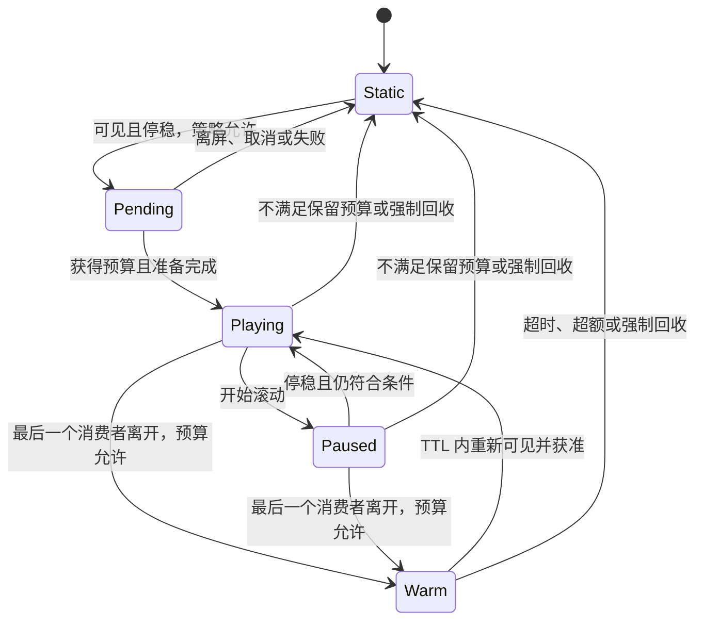

# 时间轴动态头像低内存方案

状态：首版实施说明 v4。日期：2026-10-30。已接入 Home 时间轴、搜索和通知，采用离屏停播、短期保留解码 provider、按预算回收。源码与本节末尾的实施差异优先于早期设计建议；真机 Release 的内存与滚动性能目标仍待测量。

## 1. 推荐决策

采用“静态底图 + 可见时播放 + 有预算的短期资源保留”。头像离开视口后立即撤销播放资格并解除视图绑定；同一资源的最后一个可见消费者离开后，立即暂停帧推进，释放预取帧，符合保留预算的资源短暂进入 warm 状态。超时、超额、资源较重或内存压力下销毁播放器、解码器和数据引用。磁盘保留原始文件。

早期“离屏立即全部销毁”属于内存优先的保守策略。当前版本用短暂保留吸收视口边界抖动和快速回滚，减少重复解析和首帧准备；保留时长和容量同时受限。保留的是 provider、压缩数据和首帧，轻量的 SDK 播放器随视图解绑释放，重新挂载允许从首帧开始。

动画资源由应用级资源池限额管理。缓存和下载首先按 URL 去重；同 URL、同尺寸共享播放器作为后续性能优化选项，通过基准验证后再启用。时间轴视图即使被 SwiftUI 或页面容器保留，也不持有已经离屏头像的动画资源，短期保留由资源池独立负责。

第一版沿用“设置 → 阅读 → 播放 GIF”，不新增用户开关。头像点击仍进入作者主页。搜索账号与帖子作者、通知单人／多人头像和通知参与者弹层也复用同一资源池，8 个上下文的总限额不会按页面叠加。

## 2. 当前代码依据

| 已确认事实 | 设计影响 |
|---|---|
| `MoroAvatar` 优先使用静态地址，并关闭动画 | 新能力显式接入时间轴主头像；通用组件的默认行为保持静态 |
| `PostCard` 被多个模块复用；`PostHeader` 还显示 16pt 的辅助头像 | 只给时间轴正文作者的 44pt 主头像授予资格，辅助头像、引用预览等暂保持静态 |
| 搜索账号与帖子使用 UIKit `UITableView` ＋ `UIHostingConfiguration` | 复用动画资源池，显式桥接 UIKit 的头像可见区域、滚动阶段及页面启停；不能依赖 SwiftUI ScrollView 回调 |
| 通知列表及参与者列表使用 SwiftUI 滚动容器 | 复用 60% 阈值、停稳延迟及页面 scope；参与者弹层显示时暂停后方列表 |
| 时间轴是 `ScrollView + LazyVStack`，页面容器保留各时间轴的 hosting controller | `onAppear`、`onDisappear` 和 UIView 是否挂在 window 上，都不能单独充当播放或销毁依据 |
| 时间轴已有滚动阶段、当前页面、Home 是否位于前台、弹层和 scene 状态 | 复用这些状态作为控制输入，保留刷新、阅读位置恢复和分页的既有行为 |
| 时间轴和搜索主头像为 44pt；通知头像为 30／40／44pt | 按实际显示像素选择 96／128／160px 档位，44pt @3x 使用 160px |
| 锁定 SDWebImage 5.21.6，已经具备独立 `SDAnimatedImagePlayer` | 复用现有解码及播放库，通过帧回调更新 UIKit layer |

源码入口：

- [MoroAvatar](../moro/UI/Components/MoroAvatar.swift)
- [PostCard 主头像](../moro/UI/Components/PostCard.swift)
- [时间轴滚动与阶段](../moro/Modules/Timeline/TimelineHomeView+ScrollView.swift)
- [时间轴页面容器](../moro/Modules/Timeline/TimelinePager.swift)
- [时间轴活跃状态](../moro/Modules/Timeline/TimelineHomeView.swift)
- [头像尺寸令牌](../moro/UI/Theme/Spacing.swift)

现有资料页的 `ProfileMediaImage` 适用于少量图片：暂停时仍保留动画对象。时间轴使用更严格的释放策略，已验收的个人资料播放流程继续沿用现有实现。

## 3. 用户可见行为

| 场景 | 行为 |
|---|---|
| 刚进入视口 | 立即显示静态头像；头像至少 60% 可见，并在时间轴停稳 150ms 后申请播放 |
| 获得名额、资源准备好 | 在同一尺寸内切换到动态帧，保留圆形裁切、边框和点击行为 |
| 手指滚动、惯性滚动或程序滚动 | 暂停已有动画，保留当前显示帧；仍可见头像保留有界的小帧缓冲，停止发起新的动画准备工作 |
| 停止滚动 | 重新评估可见性和预算，停稳 150ms 后恢复符合条件的头像 |
| 可见比例不满足 60% | 与 GIF、视频使用相同阈值，撤销该实例的动画资格并显示静态底图；停稳延迟和短期缓存减少边缘反复切换的代价 |
| 完全离屏、切换列表或 tab、导航到详情、被完整页面覆盖 | 立即解绑对应实例或整个页面；最后一个消费者离开后按 warm / cold 规则回收 |
| 进入后台 | 清空活跃及 warm 动画资源，保留磁盘文件 |
| 关闭“播放 GIF”、系统不允许动画、Reduce Motion、低电量模式 | 使用静态头像，并释放该能力占用的动画资源 |
| 超出预算、原文件不合适或加载失败 | 显示静态头像，原有文字、布局和点击入口保持可用 |
| 划回之前浏览的头像 | warm 命中时复用解码 provider，cold 状态从磁盘重新准备；均允许从首帧重新播放 |

“可见”需要同时满足：头像自身的可见比例、承载页面已经呈现且处于活跃状态、scene 活跃、系统和应用播放策略允许。SwiftUI 列表与现有媒体一样使用系统滚动视口的可见性回调；未另外计算顶部、底部浮层遮挡后的几何交集。搜索表格用 `UIKitScrollVisibility` 计算头像自身与 window／祖先滚动裁切区域的交集，仅发布阈值变化。

## 4. 生命周期与销毁边界

撤销资格时，按以下顺序处理：

1. 作废当前实例的请求代次，阻止已经发出的异步回调重新挂载动画。
2. 清除该实例的动画 layer 内容和资源绑定，静态底图立即接管。
3. 从资源条目中移除该消费者；其他仍可见的同资源头像继续使用各自的播放器和共享 provider。
4. 最后一个消费者离开时，SDK 播放器注销并释放共享预取帧池，取消不再需要的下载和解码准备。资源较小且有预算时，只保留 provider、压缩数据和首帧，进入无帧推进、无继续预取的 warm 状态。
5. warm 默认保留 2 秒，最多 2 个条目且保守估算占用最多 2MiB；这些名额和内存从已有全局预算中划分。新可见资源优先，LRU 淘汰 warm 条目。第一阶段活跃与 warm 播放上下文合计最多 8 个；共享播放器实施后按独立资源计数。
6. 不满足 warm 条件、TTL 到期、后台、关闭 GIF 或内存压力时，停止播放器，解除回调，移除 provider、数据引用及资源条目。较重或无法可靠估价的解码上下文直接冷回收。
7. 已经进入同步 ImageIO 调用的单帧工作可完成，但结果必须通过实例和资源代次检查后才能使用；失效结果直接释放。warm 命中时作废旧的清理任务，避免恢复后的资源又被过期回调销毁。

离屏后的停播、解绑和预取帧回收应立即发生，正常素材的重帧资源释放目标仍为 500ms 内。获准 warm 的解码上下文在 TTL 到期后释放；强制回收路径不等待 TTL。以对象生命周期及活跃任务计数验证，RSS 不要求在同一帧回到原值。

播放容器随列表复用，不在每次越过视口边界时主动销毁整个 UIView。回收控制针对动画资源。每个 warm 条目只保留一个到期清理任务，不运行离屏动画时钟。

注册身份分为三个层级：页面/scene 的 scope、具体头像实例的 token、URL 与尺寸形成的资源 key。仅用账号 ID 或 status ID 无法区分重复帖子、多个时间轴和换头像后的旧回调。

候选登记只保留当前视口需要的条目，离屏时移除。保留的视图 token 不持有动画资源，避免注册表随已经浏览的帖子数增长。

## 5. 组件与职责

| 组件 | 职责 |
|---|---|
| `TimelineAnimatedAvatar` / `AvatarAnimationSurface` | 静态底图、离散可见性报告、UIKit 播放视图；只更新头像局部状态 |
| `MediaPlaybackScope` / `MediaPlaybackPolicy` | 当前页面资格、滚动阶段、系统策略与统一可见阈值 |
| `TimelineAvatarAnimationPool` | 应用级预算、资源去重、可见引用计数、失败冷却、warm 的 TTL / LRU 及最终释放 |
| `AvatarAnimationDataStore` / `AvatarAnimationDecoder` | 有界下载、原始文件磁盘缓存、文件限制、过期处理与后台首帧准备 |

第一阶段优先复用 `SDAnimatedImageView` 的成熟播放管线，补齐可见性、缓存归属和资源预算。无论选择哪条管线，头像每帧更新都留在 UIKit 内，不发布为 SwiftUI `@State`、全局 `@Published` 或新的 Swift 并发任务。

如果基准显示同头像重复解码或多个时钟已形成明显成本，再使用单资源 `SDAnimatedImagePlayer`，通过帧回调直接更新多个可见实例的 `CALayer.contents`；此时相同头像同步播放。共享播放器、统一帧时钟和自定义帧 provider 都属于进阶优化，实施前验证收益与维护成本。

页面提供稳定的播放上下文，时间轴、搜索与通知各自在支持的头像入口显式接入。页面切换开始时使旧 scope 失效，新页面完成呈现后重新申请；缓存页面迟到的可见性事件不能恢复旧资格。全局 GIF 开关通过 `MediaPreferences` 同步给保留的页面，关闭时主动清理头像动画资源。

所有原始文件读取和首帧准备在有界后台执行器完成，主线程负责资格变更和显示。SDK 各播放器的后台解码并发需要单独观测；首次下载/准备的并发限制不能直接当作全局帧解码并发保证。确有必要时再增加 provider 包装器统一限制。

## 6. 初始资源预算

以下是首版采用的参数，后续依据 Release 真机数据调整；它们不是进程内存的实测结果。

| 项目 | 建议初值 |
|---|---|
| 同时播放 | 第一阶段应用内最多 8 个播放实例；实施共享播放器后再按独立资源计数 |
| 屏幕选择 | 保留仍可见的消费者，新候选按注册顺序准入；视口中心排序留作后续优化 |
| 解码输出 | 按显示像素选 96 / 128 / 160px 档位；44pt @3x 使用 160px，原图较小时不放大 |
| 单实例 SDK 帧缓冲 | 300KiB，约 2–3 帧；当前帧和解码器仍有额外成本 |
| 全局解码帧预算 | 4MiB；准入时按每资源最多约 512KiB 预留，必要时减少并发播放资源 |
| 在用压缩数据预算 | 全局 4MiB；从磁盘载入前按文件大小核算，超额保留静态 |
| warm 资源 | TTL 2 秒，最多 2 个、保守估算最多 2MiB；占用已有全局预算，优先被新可见资源淘汰 |
| 播放上下文数量 | 活跃与 warm 合计最多 8 个；共享播放器实施后按独立资源计数 |
| 后台首帧准备 | 并发 1；SDK 后续帧解码另外测量，必要时实施全局并发限制 |
| 下载 | 最多 2 个，各使用不超过 2MiB 的接收缓冲；每个数据块到达时检查真实字节数 |
| 单文件限制 | 2MiB，原始画布不超过 1024×1024，帧数不超过 200；超限显示静态 |
| 原始文件磁盘缓存 | 独立命名空间，64MiB，LRU 和过期清理；遵守禁止缓存的响应策略 |
| 内存压力 | 全部撤销并释放动画资源；冷却 30 秒后，在页面仍活跃且停稳时重新评估，仍受 8 个上下文总限额约束 |

静态底图复用现有静态头像路径。动画对象的保留只能通过有预算、可主动淘汰的缓存完成，避免资源池与共享 `SDImageCache` 各自长期持有一份；磁盘保存原始压缩文件。warm 之外的历史头像只留下磁盘文件与既有静态缩略图缓存。warm 的成本核算包含压缩数据、保留帧及解码器画布的保守估算；无法确认成本的资源按 cold 处理。

正常滚动时不发起新的头像准备任务；已开始的有界下载及准备可以完成，播放器保持暂停。离屏后若已无其他消费者需要该请求，则取消。头像更新以完整 URL 产生新资源 key，保留查询参数；下载去重按完整原始 URL，解码资源按 URL 和像素档位区分。

同 URL、同尺寸的实例共享同一 provider 和压缩数据；不同尺寸的条目各自计入预算。在途接收、首帧准备及准备完成后的在用数据属于不同阶段：在用数据的 4MiB 预算在准备完成、交给视图前核算，下载缓冲和准备阶段临时数据是额外成本。超预算则不挂载动画；允许缓存的原始文件仍可保留在独立磁盘缓存中。

### 内存量级

当前 44pt 头像在 3x 屏约 132×132px，一张 RGBA 帧约 68KiB。按 160px 档位计算，一帧约 100KiB，3 帧约 300KiB；8 个不同资源的这部分合计约 2.34MiB。

如果把 400×400、50 帧全部解码，则单个头像约 30.5MiB，8 个约 244MiB。因此必须按目标尺寸逐帧解码，保留全部动画帧信息而不预解码所有帧。

4MiB 帧预算与 4MiB 在用压缩数据预算用于约束准入。ImageIO 中间画布、解码器元数据、当前帧和下载缓冲仍有额外成本；不能把 SDK 的 `maxBufferSize` 当作进程总内存硬上限。第一轮真机目标为相同页面相对静态模式的新增常驻内存不超过 12MiB、短时峰值不超过 24MiB，最终以测量为准。

## 7. SDWebImage 接入注意点

已核对当前构建使用的 5.21.6 源码，revision 为 `449e8f8f10377f620db8ad22ea81208eecf6325f`。

- `stopAnimating` / `pausePlaying` 停止推进帧，不会单独释放图片和解码器。
- `maxBufferSize = 0` 代表自动计算缓冲大小，不能用于表达“释放内存”。
- 相同 provider 的播放器会共享 SDK 帧池；某个实例停下时清空共享缓冲可能影响其他可见实例。共享缓冲只在最后一个活跃消费者离开后统一回收；共享播放器可进一步简化该边界。
- 每个 SDK 帧池有自己的预取队列，因此全局解码并发需要额外包装控制。
- 需要验证显式缩略解码选项仍返回多帧 provider，且每帧尺寸均受限；现有资料页加载模式不能直接充当这一保证。
- 首帧在后台准备好后再交给主线程；当前 SDK 的播放器初始化直接复用 `SDAnimatedImage.cgImage`，无需另写 provider 包装器。
- 保留源文件帧时长与循环规则。预取不足时保持已显示帧，不通过改变播放速度减少开销。
- 同步释放播放器、帧回调、provider 和源数据；回调弱持有资源条目与渲染视图，避免循环引用。

官方能力参考：[独立 Animated Player](https://github.com/SDWebImage/SDWebImage/wiki/Advanced-Usage#animated-player-530)、[缩略解码](https://github.com/SDWebImage/SDWebImage/wiki/Advanced-Usage#thumbnail-decoding-550)。

## 8. 实施顺序与验收门槛

### A. 先验证资源管线

使用真实多帧 GIF 和现有离线测试素材验证：目标尺寸逐帧解码不丢动画；首帧准备不在主线程；离屏无持续解码；warm 命中可恢复，warm 超时或淘汰后 provider 和数据引用可回收。共享播放器和全局串行限制在进入进阶优化前单独验证。

这一步通过后再接入时间轴。若 SDK 的缩略解码不能保持动画或中间画布超预算，保持静态并调整管线后复测。

### B. 接入时间轴主头像

接入可见性、停稳延迟、当前页面、Home 活跃状态和现有 GIF 设置。辅助头像和其他模块保持静态；原有个人主页动画、媒体 GIF、刷新和导航行为进入回归。

### C. 验证低内存及滚动表现

- 同屏相同头像的下载与缓存复用，移除其中一个不会暂停其他可见实例；若实施共享播放器，再验证只有一个帧时钟。
- 快速划过时不创建解码器；离屏、切页或跳转详情后，失效 scope 的活跃播放器归零，warm 不超过 2 个并在 TTL 后归零；切账号、后台和关闭开关后，活跃与 warm 都归零。
- 对比“立即销毁”和“短期保留”：在相同预算下统计上下反复滚动时的 provider 创建次数、首帧恢复延迟、解码 CPU 和内存峰值，以实测确定 TTL。
- 模拟取消后迟到的回调，确认不会重新附着动画或把上一账号头像写进新实例。
- 连续浏览至少 1000 条帖子，再来回滚动 5 轮；动画新增内存进入平台，不随浏览历史持续增长。关闭动画后的对照使用相同数据与磁盘缓存条件。
- 覆盖超大画布、超限字节数、超长帧序列、损坏 GIF、单帧文件、失败重试冷却、低电量与内存警告。
- 在低内存真机和 3x 屏真机以 Release 对比 GIF 开/关，记录常驻/峰值内存、帧解码并发、活跃播放器、主线程耗时和滚动 hitch；暂定滚动 hitch 比例相对静态基线增幅不超过 1 个百分点。
- 分配器保留空闲页时，结合 Allocations 和对象弱引用判断释放，避免只按单次 RSS 下落认定销毁是否成功。

根据真机数据再调整播放名额和预算。当前已完成源码接入及相关模拟器回归；Release 真机 RSS、峰值、耗电和滚动 hitch 仍待测量。

## 9. 公开客户端参考与方案取舍

核对日期：2026-10-30。下面描述公开源码中的具体路径，不推断闭源客户端的内部算法，也不声称这些路径代表所有线上版本。

补充对比见[时间轴动态头像开源客户端对比](时间轴动态头像开源客户端对比.md)：本轮进一步核对 Ice Cubes、Metatext／Feditext、Mammoth 和 tooot。Metatext／Feditext 的 SDWebImage 接入最接近 Moro；Ice Cubes 锁定的 Gifu 默认缓冲参数为 50 帧且默认不缩小动画帧，不能直接作为低内存配置。上述路径没有提供固定 2 秒 warm 缓存的行业依据，该数值仍是本项目待测初值。

| 客户端 / 库 | 源码中可确认的行为 | 对 Moro 的启示 |
|---|---|---|
| Mastodon iOS | `AvatarImageView` 使用 `FLAnimatedImageView`；换数据时取消请求并重置图片。框架在视图可见性变化时启停显示链路，暂停时保留动画对象；帧缓存会按图片规模和内存压力调整 | 可见性停播、换数据清理、帧缓存回收是不同层级 |
| Telegram iOS | 头像节点的小尺寸视频路径使用动画缓存和共享 renderer，并更新 `isVisibleForAnimations`；另一视频路径不可见时移除 video node | 按资源类型、尺寸及播放场景选择保留或重建；其视频/动画头像不能直接等同于原始 GIF |
| Mastodon Web | Avatar 组件根据自动播放和 hover 选择原始或静态 URL，使用 ``；该组件本身不提供离屏解码器销毁控制 | 浏览器图片缓存与原生 ImageIO 生命周期不能直接套用 |

源码：

- [Mastodon iOS AvatarImageView](https://github.com/mastodon/mastodon-ios/blob/6d45b164ad2c5b42f07e7296464fe973abc65a12/MastodonSDK/Sources/MastodonUI/View/ImageView/AvatarImageView.swift)
- [FLAnimatedImageView 的暂停与可见性](https://github.com/Flipboard/FLAnimatedImage/blob/d4f07b6f164d53c1212c3e54d6460738b1981e9f/FLAnimatedImage/FLAnimatedImageView.m)
- [FLAnimatedImage 的帧缓存与内存压力处理](https://github.com/Flipboard/FLAnimatedImage/blob/d4f07b6f164d53c1212c3e54d6460738b1981e9f/FLAnimatedImage/FLAnimatedImage.m)
- [Telegram AvatarVideoNode](https://github.com/TelegramMessenger/Telegram-iOS/blob/fb0e62ba8a147f0821da6aa63c09da7d79a10111/submodules/AvatarVideoNode/Sources/AvatarVideoNode.swift)
- [Mastodon Web Avatar](https://github.com/mastodon/mastodon/blob/b4076a667129c14f6d536700d40379286d3d05c5/app/javascript/mastodon/components/avatar.tsx)

本次可确认的库设计将播放启停、帧缓存和图片对象释放分开处理。window／superview、hidden 和 alpha 的自动判断不等同于滚动视口判断；Moro 必须显式补齐后者。对 Moro 的推荐是复用成熟库与显示容器，增加应用级预算和有界 warm 缓存，再根据 profiling 决定共享播放器等优化；2 秒、2 个和 2MiB 都是本项目的待测初值，并非行业统一参数。

## 10. 首版实施事实与设计差异

- `MediaPlaybackPolicy` 提供统一的 60% 阈值、页面／scene／全屏资格判断；`TimelineScrollBridge` 通过独立 `MediaPlaybackScope` 控制缓存页面。Home 的跟随、本地、全站和列表时间轴、搜索账号／帖子及通知头像显式授予动画资格；资料页帖子列表、话题列表不会因复用 `TimelinePostRow` 而自动开启。
- `TimelineAvatarAnimationPool` 共享 URL＋尺寸对应的 `SDAnimatedImage` provider；每个可见实例仍使用独立 SDK 播放器。最后一个实例解绑时，SDK 共享帧池随播放器注销释放，避免某个重复头像离屏时清掉其他可见实例的帧。
- warm 仅保留 provider 和首帧，不保留播放时钟、当前位置或预取帧；重新可见时重建轻量播放器，允许从首帧开始。当前可见候选按注册顺序准入，尚未实现按视口中心排序。
- `AvatarAnimationDataStore` 独立保存压缩原始文件，禁用动画对象的共享内存缓存；最多 2 个下载，接收过程中限制 2MiB，尊重 `no-store`，磁盘缓存 64MiB、7 天到期。取消最后一个下载消费者时取消传输。
- `AvatarAnimationDecoder` 在后台 actor 串行准备首帧，验证帧数、文件大小、首帧尺寸及 GIF 逻辑画布；逐帧缩略解码已通过多帧素材验证。SDK 后续帧使用各自的后台队列，本次没有实现全局后续帧解码并发限制。
- 内存压力清空资源并冷却 30 秒，之后通过一次恢复信号重新评估；后台、关闭动画和切换账号主动清理。SDK 缓冲不是整个进程内存的硬上限，前述 12／24MiB 为未验收的真机目标。
- GIFV／视频离屏后归还播放器；已有 3 个播放器的缓存增加了 2 秒 TTL。手动 GIF／GIFV 播放一轮，自动模式全屏返回后恢复播放；全屏先解除系统控制器引用再交回资格，避免迟到的暂停覆盖恢复操作。

时间轴媒体首轮回归为 100 项测试、114 次执行，0 失败：含 1,000 个不同头像的资源池连续加载、重复头像一方离开后另一方持续推进、warm 到期弱引用释放、真实原始 GIF／MP4 单次与循环播放、取消后迟到回调、全屏返回像素变化、保存到相册、系统分享、切页与图片旋转回归。该压力测试验证资源池有界，不等同于 1,000 条真实时间轴的真机性能测试。运行记录：`build/qa/timeline-media/verification.md`。

### 搜索与通知扩展

- `SearchCoreViewController` 持有稳定 scope 和弱引用 `UIKitScrollVisibility` 探针集合；现有滚动 delegate 刷新可见性，不为每个头像增加 DisplayLink、定时器或滚动 KVO。进入搜索输入页、导航或离开当前 tab 时停止，重新显示列表后再等待停稳。
- 搜索账号与帖子显式接收所属 SwiftUI scene 的 GIF 设置、账号标识和系统动画资格，避免独立 `UIHostingConfiguration` 使用默认设置。
- 通知主头像、最多三个聚合头像及参与者列表使用同一资源池。父列表由 `isActive`、生命周期及参与者弹层共同控制；弹层使用自己的 scope 和滚动状态。
- 搜索单元格复用和 UIKit 延后可见性通知均有取消边界；视图脱离后迟到的通知不能重新赋予播放资格。

扩展回归覆盖 42 项单元与 7 项界面测试，按各用例最新结果均通过；最终定向运行 13 项全部通过。搜索像素帧推进、通知弹层／详情／tab 切换回收及阅读位置返回已验证。记录：`build/qa/list-avatars/verification.md`；Release 真机性能仍待测量。
